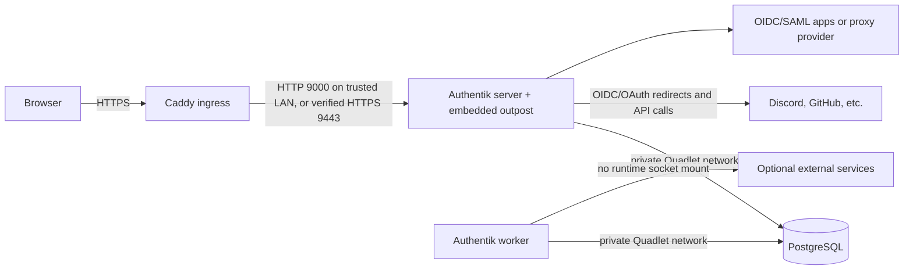

# Self-hosted central authentication provider for a Quadlet environment

**Research date:** 2026-10-12  
**Question:** Which self-hosted central identity provider best fits this Fedora CoreOS/Podman Quadlet environment?  
**Scope:** Authentik, Keycloak, ZITADEL, and Authelia; separate host is allowed. Documentation-based evaluation, not a deployment or compatibility test.

## Thinking

### Scope and questions

1. Which provider protocols and app-integration models match a central identity service, rather than only reverse-proxy access control?
2. What do MFA/passkeys, LDAP, SAML, licensing, database dependencies, and operational footprint mean for selection?
3. How well do official deployment materials align with Fedora CoreOS, Podman, and Quadlet?
4. What security and availability constraints follow from centralizing authentication, especially on a separate host?

### Evidence standard and verification plan

Prefer provider-maintained documentation for product behavior, standards bodies for protocol distinctions, and Podman/Fedora/PostgreSQL documentation for operational claims. Cross-check consequential claims against at least three independent authoritative sources when available. Confidence is **HIGH** when multiple independent authoritative sources support the claim, **MEDIUM** when support is primarily two sources or product-specific claims rely on vendor documentation, and **LOW** when evidence is limited to one source or remains unverified. Provider feature claims are often best evidenced by the provider's own current documentation; they are not presented as independently verified product tests.

### Existing environment constraints

The repository manages Fedora CoreOS services with rootful Podman Quadlet and systemd. Shared and machine-specific state is Git-managed; mutable service data belongs under `/var/lib/`; secret values belong behind fnox references. `systems/dev-lan` currently uses Caddy Docker Proxy and an internal CA. A separate host is acceptable. These constraints favor declarative Quadlet files, durable host storage, pinned images, explicit backups, and no unnecessary Podman socket access. [R1–R5]

The local research directory already exists at `docs/research/`, so this report uses that path rather than introducing a new `.memory/` store.

## Research

### Executive comparison

| Provider | Strongest fit | Main limitation for this use | Quadlet evidence |
|---|---|---|---|
| **Obligator** | Lightweight, opinionated OIDC provider with upstream GitHub/GitLab/Google and other OAuth/OIDC login, plus forward-auth | Email-centric; no SAML/LDAP/MFA documented in the reviewed feature set; access rules appear email allowlist/global-public rather than rich per-service policy | Static executable or container; Quadlet is plausible but not documented as a supported deployment recipe |
| **Authentik** | Broad, self-hosted app identity and access: OIDC, SAML, LDAP service, proxy provider, GitHub/Facebook/GitLab/Discord login and WebAuthn/passkeys | Multiple service roles and PostgreSQL; more components than proxy-only auth | Official docs explicitly list Podman as a host option; no official Quadlet recipe found |
| **Keycloak** | Broad standards-based IAM, including OIDC/SAML and LDAP/AD user federation; mature production guidance | More configurable operating surface; production image/database/proxy setup requires deliberate work | Official docs explicitly discuss Podman and optimized container images; best documented Quadlet-adjacent fit |
| **ZITADEL** | Modern OIDC/SAML identity on PostgreSQL, with passkeys and clear separation of setup/migration/runtime | PostgreSQL required; not an LDAP server; AGPL terms; official deployment path is Compose, not Quadlet | Quadlet use is plausible OCI adaptation, not vendor-documented support |
| **Authelia** | Lower-complexity MFA/forward-auth for apps already behind a reverse proxy | Primarily proxy-gateway authentication; not SAML and not an LDAP service; its OIDC provider is documented as beta | Official deployment docs focus on Docker; Quadlet adaptation is unverified |
| **Other projects from Obligator’s comparison** | Rauthy, Portier, Dex, Ory, Vouch, oauth2-proxy, Casdoor, and Kanidm screened below against the user's two requirements | Obligator's comparison is explicitly incomplete and may be incorrect; this screen uses current project docs and distinguishes proxy middleware from an IdP | Provider-specific Quadlet guidance remains sparse; see source notes |

For the stated combination—selectable upstream login and central per-service admission—**Authentik is the strongest fit found so far**: it has documented GitHub, Facebook, GitLab, and Discord sources, plus application bindings/policies that can restrict which users or groups may access each application. Its Discord integration can also map guild roles to Authentik groups and apply guild/role membership policies during login. Reddit remains unverified. **Casdoor is the main additional candidate** if its built-in GitHub/Facebook/GitLab sources are attractive, but external services must enforce Casdoor's roles/permissions themselves; verify each service's integration before selecting it. Use Keycloak as a strong general-purpose OIDC/SAML alternative, but confirm provider-specific upstream social-login paths and per-client authorization behavior. Caddy forward-auth can protect services that lack native federation; each protected app still needs its own access binding/policy. [R6, R46]

### Provider details

#### Authentik

Authentik documents OIDC/OAuth2, SAML, LDAP, proxy and other provider integrations. Its LDAP provider exposes users/groups to LDAP clients; this is a meaningful distinction from a product that can only connect to an upstream LDAP directory. Its WebAuthn flow covers security keys/platform authenticators and passkeys. Official Compose installation material lists Podman or Docker Compose and a baseline of 2 CPU cores and 2 GB RAM; it describes this path for test and small-scale production. The architecture comprises PostgreSQL, server and worker roles. The Docker socket mount is used for automatic outpost management, is documented as a security risk, and can be omitted when outposts are managed manually. [R6–R9]

**Fit:** Best feature breadth among the compared candidates when LDAP service, reverse-proxy integrations, and multiple app protocol patterns are relevant. It introduces more than one application process plus PostgreSQL. Current official compose artifacts reviewed do not include Redis; do not carry forward outdated Redis-required assumptions. Back up PostgreSQL, `/data` if used, and any used certificates/custom templates. Authentik does not support downgrade-based rollback; backup and staged upgrade are mandatory. [R7–R10]

#### Keycloak

Keycloak documents OIDC, SAML, external identity brokering, LDAP/Active Directory user federation, authentication flows and passkeys. The reviewed documentation establishes LDAP federation as a source integration, not a general LDAP server for downstream consumers. The official container guide documents Podman commands, PostgreSQL configuration, and building an optimized image. Its production guidance calls for HTTPS, an explicit public hostname, correctly configured reverse-proxy forwarding, and a production-grade database. Readiness endpoints are available when enabled. [R11–R14]

**Fit:** Strong choice for a broad standards-oriented IdP, especially if LDAP/AD is an upstream directory or custom IAM behavior matters. It maps well to an immutable image plus Quadlet, but PostgreSQL, optimized image builds, proxy/hostname configuration, and database-aware upgrades need deliberate operations. The project docs reviewed do not provide a directly comparable minimum-resource baseline. [R11–R14]

#### ZITADEL

ZITADEL documents OIDC and SAML endpoints, passkeys, and an LDAP identity-provider integration that authenticates against an existing LDAP server and can map/create user accounts. The reviewed official docs do not show ZITADEL serving an LDAP directory to downstream apps. Self-hosting requires PostgreSQL (documented supported range 14–18); Redis is optional. Its proxy must support HTTP/2 upstream. The Compose quick-start includes PostgreSQL and Traefik and sets a minimum host baseline of 2 GB RAM. Licensing is AGPL-3.0-only with stated exceptions for specific components/packages; assess obligations against actual use. [R15–R19]

**Fit:** Viable for OIDC/SAML when its PostgreSQL requirement, HTTP/2 proxy path, and AGPL terms are acceptable. The project documents Compose rather than Podman Quadlet, so direct Quadlet deployment support is not established. Preserve its encryption master key: the official deployment guidance says it cannot be changed after initialization without losing access to encrypted data. [R15–R19]

#### Authelia

Authelia focuses on authentication portal and forward-auth for applications behind a reverse proxy. It supports TOTP and WebAuthn/passkey login. Its OIDC provider documentation labels the feature beta and says it does not support the relying-party/client role; no SAML support was found in the reviewed official protocol documentation. LDAP is an upstream user-authentication backend, not an LDAP service. Storage options include SQLite, MySQL and PostgreSQL; Redis is optional for sessions and recommended for highly available deployments. It is Apache-2.0 licensed. [R20–R25]

**Fit:** Consider it if the actual target is MFA-protected web apps behind Caddy, and client applications do not need a mature OIDC client role, SAML, or an LDAP directory exposed by the provider. Do not equate forward-auth with universal SSO. OIDC conformance certification exists for selected profiles, but that does not negate the product's current beta label or mean it supports an OIDC relying party. [R20–R26]

#### Obligator

Obligator describes itself as a simple, opinionated OIDC provider for self-hosters. Its README lists upstream social login (GitLab, GitHub, Google and others), support for OIDC and some plain OAuth2 providers, forward-auth, email login, and static executable or SQLite/flat-file storage. Its model is explicitly email-centric. The README says only approved email addresses may authenticate unless `public: true` is set; it also describes anonymous OAuth clients. Those claims suggest low-friction login, but the documented allowlist is not evidence of role/group-based per-service authorization. The README says its API is currently available over Unix sockets, is undocumented/in flux, and is unauthenticated; treat socket access as a sensitive local control surface. [R37]

**Fit for this request:** Obligator is relevant if the priority is letting users authenticate through selected upstream providers and serving OIDC/forward-auth to apps. GitHub and GitLab are explicitly named in the README, but provider support is not uniform: the current OAuth callback's plain OAuth profile handler contains a GitHub-only implementation, and other non-OIDC providers fall through to an error. Discord does not provide OIDC, so the documented Discord OAuth flow does not work in Obligator without code changes to fetch/map the Discord user profile. [R37, R47, R48]

For service access, Obligator's documented model is email allowlisting or public login, not per-service user/group policies. It does not document Discord guild-role synchronization or a way to use those roles to authorize individual services. By contrast, Authentik documents a Discord OAuth source, optional guild-role-to-group mapping, guild/role login policies, and per-application user/group bindings. Authentik is therefore a substantially better fit for "Discord login + choose which users can access each local service." [R37, R46–R48]

The comparison page names Portier, Rauthy, Authelia, Authentik, Keycloak, Vouch, oauth2-proxy, Dex, Ory, ZITADEL, Casdoor, and Kanidm. The additional candidates listed there received a targeted documentation screen below; that screen does not independently re-evaluate every protocol checkbox in the comparison table or every deployment/operations concern. The table remains a discovery list because its author says it is incomplete and possibly inaccurate. [R37–R45]

#### Additional candidates listed in Obligator’s comparison

This is a targeted documentation screen, not a full operational audit. It addresses upstream social login and local-service access, not every feature in Obligator’s table. The upstream provider and client allowlists of proxy middleware control a proxy configuration; they do not make that middleware a central identity provider.

| Candidate | Social-provider evidence | Per-service access fit | Result for this request |
|---|---|---|---|
| **Casdoor** | First-party docs show GitHub, Facebook, GitLab.com/self-managed GitLab and configurable custom OAuth providers. Reddit is not documented as built-in; custom OAuth is not proof it works. | Supports groups, roles and Casbin permission policies. Its docs distinguish Casdoor's own application authorization from external apps: local services must enforce claims or call Casdoor authorization APIs. | Strong candidate if explicitly documented upstream providers are the priority. Verify how each local service consumes Casdoor roles/permissions before treating access as centrally enforced. [R38] |
| **Kanidm** | No upstream social-login/federation path found; its OAuth2/OIDC docs describe Kanidm as issuer for apps, not as broker for GitHub/Facebook/etc. | Group membership can map to per-client scopes and claims; app must enforce authorization based on them. | Does not meet the selectable third-party login requirement based on reviewed docs. Useful if local Kanidm-managed accounts and OIDC-client group scopes are acceptable instead. [R39] |
| **Dex** | Official connectors include GitHub and GitLab (GitLab marked beta); no dedicated Facebook or Reddit connector found. Generic OAuth2 connector is alpha, not verified Reddit support. | Can emit GitHub organization/team groups in OIDC tokens; clients/proxies must enforce service permissions. | A small OIDC broker candidate for GitHub/GitLab, but not a built-in per-service access manager. [R40] |
| **Ory (Kratos/Hydra/Keto)** | Kratos has documented GitHub, Facebook, and GitLab social sign-in. A Reddit documentation route exists, but the reviewed page did not establish a supported provider configuration; treat Reddit as unverified. | Hydra is an OAuth2/OIDC server, not a complete user-facing identity system alone; Keto provides a separate authorization service. More components and integration are needed to get per-service policy. | Functional potential, but a composed stack rather than a single simple provider. Validate Reddit and authorization integration against the actual local apps. [R41] |
| **Rauthy** | Official docs describe upstream providers as beta and give GitHub as the documented setup; Facebook, GitLab, and Reddit were not established. | Offers OIDC plus forward-auth and PAM/NSS user/group management. OIDC app permissions still require app/proxy enforcement. | Not a match for the requested choice among several social providers based on reviewed docs. [R42] |
| **oauth2-proxy** | First-party provider list includes GitHub, Facebook and GitLab; Reddit is not listed. GitHub org/team/user restrictions and GitLab group/project restrictions are documented. | Proxy-level allowlists and groups can gate requests, but it is an OAuth/OIDC client/proxy, not an IdP. It does not provide a central downstream SSO issuer or service-by-service policy console. | Good ingress gate where provider-specific restrictions suffice; not a replacement for Authentik/Keycloak as the service identity provider. [R43] |
| **Vouch** | Official examples cover GitHub and selected other providers, but not Facebook, GitLab or Reddit. Generic OIDC is not evidence of provider compatibility. | Mainly a proxy gate with global allowlist and GitHub team restrictions; fine-grained policy must be implemented in the app/proxy. | Narrower proxy middleware, not a central IdP with delegated per-service policy. [R44] |
| **Portier** | Email-based identity broker; reviewed materials do not document GitHub, Facebook, Reddit or GitLab as selectable upstream social providers. | No user/group policy engine for per-service access established in reviewed materials. | Does not match the stated social-provider choice requirement. [R45] |

Across these candidates, **Reddit remains unverified**. Discord is confirmed for Authentik, which documents login plus optional guild/role synchronization and policy checks. Do not rely on generic OAuth/OIDC configuration claims as proof: upstream providers differ in endpoints, claims, scopes, and whether they implement OIDC discovery. Test account linking and access behavior for your chosen apps.

### Deployment and operation in this repository

Quadlet generates systemd services from declarative files and supports container, volume, network, and other unit types, plus dependencies and container health-check options. It suits this repo's host-service model. It is not an application orchestrator: DB readiness, schema migrations, and provider readiness still need correct dependencies and health behavior. Podman auto-update restarts units and can roll back on service-start failure, but a successful unit restart does not prove successful login or safe database migration. [R1, R2, R27]

All three broad IdPs depend on PostgreSQL for durable identity/configuration state. PostgreSQL documentation describes SQL dump, filesystem, and continuous-archive methods; choose one that matches recovery objectives, store backups off-host, and test restore. Authentik also needs its used uploaded files/certificates/templates; ZITADEL's master key must be backed up separately from its database; Keycloak upgrades may make a migrated database incompatible with the prior server, requiring a matching DB backup for rollback. A container-image rollback alone is insufficient. [R10, R14, R18, R28, R29]

For a Quadlet deployment, represent the database and provider roles explicitly, persist state under durable `/var/lib/<service>/` storage, put secrets behind fnox references, pin image versions/digests, and configure systemd ordering plus actual readiness checks. Do not mount the rootful Podman socket unless a chosen provider feature requires it; Authentik documents manual outpost management as the alternative. OS updates on Fedora CoreOS and application/database updates have different rollback semantics and should be planned separately. [R1, R2, R4, R10, R27–R29]

### Proposed Quadlet topology for Authentik

This is a deployment design, not deployed configuration. For the first instance, run Authentik and PostgreSQL on one dedicated Fedora CoreOS host; keep the database private and let the existing Caddy ingress proxy reach only Authentik's web listener. This separates identity/database lifecycle from application hosts without pretending that one host provides high availability.



**Containers and units:** three `.container` units and one private `.network`; optionally one `.volume` for PostgreSQL. The server and worker use the same pinned `ghcr.io/goauthentik/server:<version>` image with commands `server` and `worker`. PostgreSQL uses a supported pinned image. The compose manifest at research time uses `postgres:16-alpine`, separate server/worker, PostgreSQL, `/data`, and optional templates/certificates; it mounts Docker socket only on worker for automatic outpost management. There is no need for that socket in a manually managed outpost/proxy arrangement. [R8, R10, R49]

| Quadlet | Responsibilities | Network/persistence |
|---|---|---|
| `authentik.network` | Private bridge for app components | No host ports |
| `authentik-db.volume` | Persistent PostgreSQL data | Rootful Podman volume under Podman's `/var/lib/containers/storage`; back up with PostgreSQL-native tools, not by copying a live PG data directory |
| `authentik-postgresql.container` | Database, `pg_isready` health check, health-gated systemd readiness | Private network only; no `PublishPort`; attached DB volume |
| `authentik-server.container` | Browser login, API, embedded outpost, OIDC/SAML and proxy integrations | Private DB network; publishes only HTTP 9000 or HTTPS 9443 to intended ingress; persist `/data`; optionally `/templates` |
| `authentik-worker.container` | Background jobs, email, event tasks, blueprint/certificate watching | Private DB network; share `/data`; mount `/certs` and `/templates` only if used; no Podman socket |

With the repository's reconciliation model, place these files under the selected identity machine tree's `quadlets/`; list generated `authentik-*.service` units in `units`. Keep non-secret config under `config/`; mutable uploaded files and templates belong under `/var/lib/authentik/` on the host, with SELinux `:Z` on bind mounts as appropriate. A named Podman volume is convenient for PG persistence; ensure the host's Podman storage path itself is backed by durable storage and included in backup/restore operations. [R1, R3–R5]

**Secrets:** fnox resolves the names in `fnox.toml` into values for a command; systemd does not inherit a developer's interactive fnox environment when it starts Quadlet services later. Bridge the boundary by provisioning rootful Podman secrets from fnox on the target (or over the authenticated SSH channel), then reference only Podman secret names in the Quadlets. Do not check in resolved `.env` files or use `fnox export` as a deployment file unless it is a deliberate, protected, short-lived provisioning artifact. Podman secrets are stored on the host and mounted into containers at creation; host root remains trusted. PostgreSQL's official image supports `POSTGRES_PASSWORD_FILE`; Authentik supports `file://` configuration values. Use separate secrets for the database password and stable `AUTHENTIK_SECRET_KEY`, expose them only to required units, and recover both with off-host backups. [R49, R54–R56]

Illustrative fnox references (provider configuration omitted; `provider` and `value` must match the chosen vault/secret backend):

```toml
[secrets]
AUTHENTIK_PG_PASSWORD = { provider = "your-provider", value = "path/to/authentik-pg-password" }
AUTHENTIK_SECRET_KEY = { provider = "your-provider", value = "path/to/authentik-secret-key" }
```

Provision Podman secrets without writing plaintext to a file:

```sh
fnox exec -- sh -c 'printf %s "$AUTHENTIK_PG_PASSWORD"' |
  sudo podman secret create --replace authentik-pg-password -

fnox exec -- sh -c 'printf %s "$AUTHENTIK_SECRET_KEY"' |
  sudo podman secret create --replace authentik-secret-key -
```

The first command resolves the fnox reference and writes its value to the pipe; `podman secret create` reads stdin into the rootful Podman secret store. On a separate host, send that stdin through SSH to the target's rootful `podman secret create`; do not pass secret values as command-line arguments. Quadlet units then mount them:

```ini
# PostgreSQL container
Secret=authentik-pg-password
Environment=POSTGRES_PASSWORD_FILE=/run/secrets/authentik-pg-password

# Authentik server and worker
Secret=authentik-pg-password
Secret=authentik-secret-key
Environment=AUTHENTIK_POSTGRESQL__PASSWORD=file:///run/secrets/authentik-pg-password
Environment=AUTHENTIK_SECRET_KEY=file:///run/secrets/authentik-secret-key
```

Podman copies secrets into a container when it is created. Replacing a Podman secret does **not** update already-running containers; recreate the affected containers. Rotating the PostgreSQL password also requires updating the database role password in a coordinated procedure. Keep `AUTHENTIK_SECRET_KEY` stable; it is recovery-critical, not a routine rotation token. [R1, R54–R56]

Illustrative unit fragments; replace image digests, secret object names, host paths, and ingress address during implementation:

```ini
# authentik.network
[Network]
NetworkName=authentik

[Install]
WantedBy=multi-user.target
```

```ini
# authentik-db.volume
[Volume]
VolumeName=authentik-db

[Install]
WantedBy=multi-user.target
```

```ini
# authentik-postgresql.container
[Unit]
Description=Authentik PostgreSQL

[Container]
Image=docker.io/library/postgres:16-alpine@sha256:<reviewed-digest>
Network=authentik.network
NetworkAlias=postgresql
Volume=authentik-db.volume:/var/lib/postgresql/data
Environment=POSTGRES_DB=authentik
Environment=POSTGRES_USER=authentik
Environment=POSTGRES_PASSWORD_FILE=/run/secrets/authentik-pg-password
Secret=authentik-pg-password
HealthCmd=pg_isready -U authentik -d authentik
HealthInterval=10s
HealthRetries=6
HealthTimeout=5s
HealthStartPeriod=30s
Notify=healthy

[Service]
Restart=always

[Install]
WantedBy=multi-user.target
```

```ini
# authentik-server.container
[Unit]
Description=Authentik server
Requires=authentik-postgresql.service
After=authentik-postgresql.service

[Container]
Image=ghcr.io/goauthentik/server:<pinned-version-or-digest>
Exec=server
Network=authentik.network
Environment=AUTHENTIK_POSTGRESQL__HOST=postgresql
Environment=AUTHENTIK_POSTGRESQL__NAME=authentik
Environment=AUTHENTIK_POSTGRESQL__USER=authentik
Environment=AUTHENTIK_POSTGRESQL__PASSWORD=file:///run/secrets/authentik-pg-password
Environment=AUTHENTIK_SECRET_KEY=file:///run/secrets/authentik-secret-key
Environment=AUTHENTIK_LISTEN__TRUSTED_PROXY_CIDRS=<actual-caddy-source-cidr>
Secret=authentik-pg-password
Secret=authentik-secret-key
Volume=/var/lib/authentik/data:/data:Z
PublishPort=<ingress-bind-address>:9000:9000

[Service]
Restart=always
TimeoutStartSec=900

[Install]
WantedBy=multi-user.target
```

The worker uses the same image, DB/secret settings, network, and data mount with `Exec=worker`; add `HealthCmd=ak healthcheck`, health intervals/retries, and `Notify=healthy` per Authentik's worker monitoring guidance. It needs no published ports. Authentik's Compose manifest grants the worker root and mounts Docker socket for automated outpost management; do not copy those settings blindly. Start without the socket; if a needed feature requires it, revisit that privilege boundary separately. [R1, R8, R10, R51]

**Readiness:** Quadlet translates `Notify=healthy` into systemd readiness that waits for the container's Podman health check. This makes PostgreSQL's `pg_isready` check a useful dependency gate for the server/worker `After=`/`Requires=` relationships. Authentik's server has `/-/health/live/` and `/-/health/ready/`; the ready endpoint verifies PostgreSQL connectivity. Monitor that HTTP endpoint from the host/ingress. The worker supports `ak healthcheck` and its own ready endpoint. Systemd service active alone is not proof that authentication works; smoke-test one actual OIDC flow. [R1, R51]

**Network choices:**

- If Caddy and Authentik share a host, attach the server to the trusted ingress network and the private Authentik network; do not attach PostgreSQL or worker to the ingress network. Avoid publishing DB ports.
- If Authentik runs on another host, Podman networks do not span machines. Publish only the server listener on a fixed private host address and firewall it to Caddy. Existing Caddy's Podman socket cannot discover containers on the remote host; configure an explicit upstream route at ingress rather than assuming remote container-label discovery.
- Prefer trusted TLS from Caddy to Authentik across hosts (valid internal-CA certificate, Caddy trusts that CA). If using HTTP 9000, restrict the path to a trusted private segment. Set `AUTHENTIK_LISTEN__TRUSTED_PROXY_CIDRS` to the address/network from which Authentik actually sees Caddy; do not blindly keep the broad default RFC1918 ranges. Caddy must overwrite forwarded host/proto/for headers and pass WebSocket upgrade headers; Authentik supports HTTP/1.1+ reverse proxies. [R52, R53]

**Persistence and update policy:** PostgreSQL stores configuration, users, policies, flows and sessions. Back up PostgreSQL with `pg_dump`/`pg_dumpall` or continuous archiving and keep copies off-host; restore DB before bringing Authentik online. Back up `/data` if using uploads; back up `/certs` only for certificates stored there, custom templates if changed, and blueprints if used. Keep the secret key separate from the DB backup. Pin server and worker to the same reviewed version/digest. Before upgrading, back up DB, review release notes, follow every required major-version hop, upgrade outposts at the same time, and verify auth. Authentik does not support downgrade; reverting the image without restoring the matching DB is unsafe. [R10, R50]

**Repository-specific first rollout:** add a dedicated machine tree (or use existing common services only if every host should run Authentik); set up durable `/var/lib/authentik`; provision secrets outside Git; add the network, volume, PG, server and worker units; add the generated service names; and configure Caddy ingress for the stable auth hostname and OAuth callback. Test DB readiness/restart, server and worker readiness, Discord login, Discord guild/role policy, one OIDC service, one proxy-protected service, backup/restore, and remote-host firewall/TLS. Exact service tree, hostname, internal TLS mode, database image/digest, and whether Caddy is local or remote remain deployment decisions—not settled by documentation.

The following sources support the design fragments. The snippets have not been run through the target host's Quadlet generator; verify syntax against its installed Podman version before deployment.

### Security and availability

Prefer native OIDC or SAML integrations where available. OIDC is an identity layer over OAuth; an ID token conveys an authentication assertion to its client, while access tokens authorize requests to protected resources. LDAP is a different directory protocol. Simple LDAP binds without TLS expose reusable credentials; restrict LDAP to known clients and use validated LDAPS or StartTLS. **Confidence: HIGH** for protocol distinctions and LDAP transport risks (IETF/OIDC/SAML primary standards and product docs agree). [R30–R33]

TLS and reverse-proxy trust are security boundaries. If Caddy terminates external TLS, configure trusted forwarded headers and restrict direct backend access so clients cannot spoof proxy metadata. Keycloak recommends secure communication, correct hostname/proxy configuration, and limiting exposure of admin endpoints; Authentik documents trusted proxy requirements. For an IdP on another machine, use a private restricted link and preferably trusted TLS between proxy and IdP; verify internal CA trust on all clients and upstreams. **Confidence: HIGH** on vendor guidance and OAuth security principles; the live Caddy routes/firewall were not tested. [R12, R13, R34–R36]

Central identity becomes a shared dependency. A separate host can isolate database/service state from app-host maintenance, but does not provide high availability: during IdP outage, new logins, token refreshes, or app-specific checks may fail depending on app/session/token behavior. Maintain emergency local admin access, backups, restore procedures, stable DNS and certificate renewal, and an explicit recovery path. Test with each actual relying application; product literature cannot establish app-specific outage behavior. **Confidence: MEDIUM** (provider production guidance and standards support the dependencies; the precise blast radius is app-specific and not tested). [R12, R18, R28–R30]

## Verification

### Claim confidence and contradictions

| Claim | Confidence | Verification and contradictions |
|---|---|---|
| Quadlet fits declarative host services but does not supply provider-level readiness or DB recovery | HIGH | Podman manual + Fedora CoreOS docs + PostgreSQL backup manual. Podman unit rollback covers failed restarts, not schema/data correctness. |
| Authentik is broad and explicitly documents Podman, with PostgreSQL/server/worker | MEDIUM | Authentik first-party docs and compose artifact; provider-specific component claims rely on those primary docs. Current artifact lacks Redis despite older third-party/legacy guidance describing Redis as required. |
| Keycloak is a broad OIDC/SAML provider with LDAP federation and explicit Podman container guidance | MEDIUM | Keycloak official admin, container, production, and health docs. LDAP federation must not be mistaken for LDAP service. |
| ZITADEL supports OIDC/SAML and upstream LDAP, but requires PostgreSQL and a compatible HTTP/2 proxy | MEDIUM | ZITADEL official API, LDAP, requirements and deployment docs. LDAP navigation can misleadingly imply LDAP server functionality; concrete guide describes upstream authentication. Compose documentation is not evidence of Quadlet support. |
| Authelia is strongest for forward-auth rather than universal SSO; OIDC provider status is beta | MEDIUM | Official Authelia docs plus OpenID Foundation certification listing. Certification covers selected OP profiles and does not establish an RP role or override the beta label. |
| Obligator documents upstream social login, OIDC and forward-auth but describes an email-centric admission model | MEDIUM for project-stated functionality; LOW for Reddit interoperability and rich per-service authorization | Project README is primary evidence. “Etc” and generic OAuth2 support do not establish Reddit compatibility. The comparison table itself is explicitly labeled incomplete and potentially inaccurate. |
| Central IdP needs careful TLS, proxy and recovery treatment | HIGH for security configuration; MEDIUM for app outage effects | OAuth security BCP, Keycloak and Authentik proxy docs, PostgreSQL backup docs; exact runtime consequences depend on each integrated app. |
| Authentik offers documented upstream GitHub/Facebook/GitLab/Discord sources and assignable per-application access bindings | MEDIUM | Authentik's current social-login docs list provider-specific integrations; application docs state bindings restrict which users can see/access an application. Its Discord guide also documents guild/role mapping and policies. Product-maintained docs, not a live test. Reddit is not verified. |
| Casdoor has built-in GitHub/Facebook/GitLab and group/permission features, but external app policy requires app enforcement | MEDIUM | Casdoor first-party OAuth provider and permission docs distinguish Casdoor's internal application permissions from external service authorization. |
| Candidate comparison points to additional viable/mismatched products | MEDIUM | Rauthy, Portier, Dex, Ory, oauth2-proxy, Vouch, Casdoor and Kanidm project docs checked; absences from docs do not prove technical impossibility. Reddit support remains unknown. |

### Sources

Accessed 2026-10-12 unless a version/date is stated. **Official docs/artifact** indicates vendor or project documentation; **standard** indicates primary standards-body material; **platform/operations** indicates primary platform or database documentation.

- **R1** — [Podman Quadlet manual](https://docs.podman.io/en/stable/markdown/podman-systemd.unit.5.html), Podman project, platform manual.
- **R2** — [Podman auto-update manual](https://docs.podman.io/en/latest/markdown/podman-auto-update.1.html), Podman project, platform manual.
- **R3** — [Fedora CoreOS storage](https://docs.fedoraproject.org/en-US/fedora-coreos/storage/), Fedora Project, platform documentation.
- **R4** — [Fedora CoreOS automatic updates](https://docs.fedoraproject.org/en-US/fedora-coreos/auto-updates/), Fedora Project, platform documentation.
- **R5** — [Repository desired-state model](../explanation/desired-state-model.md), this repository, architecture documentation; [repository reference](../reference/repository.md), this repository, reference documentation; [GoDoxy integration research](godoxy-integration.md), this repository, existing deployment research. Local evidence, not an independent external source.
- **R6** — [Authentik provider types](https://docs.goauthentik.io/add-secure-apps/providers/), Authentik project, official product documentation.
- **R7** — [Authentik Compose installation](https://docs.goauthentik.io/install-config/install/docker-compose), Authentik project, official deployment documentation.
- **R8** — [Authentik architecture](https://docs.goauthentik.io/core/architecture), Authentik project, official architecture documentation.
- **R9** — [Authentik LDAP provider](https://docs.goauthentik.io/add-secure-apps/providers/ldap/), and [WebAuthn authenticator stage](https://docs.goauthentik.io/add-secure-apps/flows-stages/stages/authenticator_webauthn), Authentik project, official feature documentation.
- **R10** — [Authentik backup/restore](https://docs.goauthentik.io/sys-mgmt/ops/backup-restore), and [upgrading](https://docs.goauthentik.io/install-config/upgrade), Authentik project, official operations documentation; [current Compose artifact](https://docs.goauthentik.io/compose.yml), Authentik project, first-party deployment manifest.
- **R11** — [Keycloak server administration guide](https://www.keycloak.org/docs/latest/server_admin/), Keycloak project, official product documentation.
- **R12** — [Keycloak production configuration](https://www.keycloak.org/server/configuration-production), Keycloak project, official production guide.
- **R13** — [Keycloak reverse proxy](https://www.keycloak.org/server/reverseproxy), and [hostname configuration](https://www.keycloak.org/server/hostname), Keycloak project, official operations documentation.
- **R14** — [Keycloak containers](https://www.keycloak.org/server/containers), [database configuration](https://www.keycloak.org/server/db), and [health](https://www.keycloak.org/observability/health), Keycloak project, official technical documentation.
- **R15** — [ZITADEL API introduction](https://zitadel.com/docs/apis/introduction), and [SAML login guide](https://zitadel.com/docs/guides/integrate/login/saml), ZITADEL project, official API/product documentation.
- **R16** — [ZITADEL LDAP identity provider](https://zitadel.com/docs/guides/integrate/identity-providers/ldap), ZITADEL project, official integration guide.
- **R17** — [ZITADEL passkeys](https://zitadel.com/docs/concepts/features/passkeys), ZITADEL project, official feature documentation.
- **R18** — [ZITADEL requirements](https://zitadel.com/docs/self-hosting/manage/requirements), [Compose deployment](https://zitadel.com/docs/self-hosting/deploy/compose), [database operations](https://zitadel.com/docs/self-hosting/manage/database), [production checklist](https://zitadel.com/docs/self-hosting/manage/productionchecklist), ZITADEL project, official deployment/operations docs.
- **R19** — [ZITADEL licensing policy](https://github.com/zitadel/zitadel/blob/main/LICENSING.md), ZITADEL source repository, primary licensing statement.
- **R20** — [Authelia OIDC provider](https://www.authelia.com/configuration/identity-providers/openid-connect/provider/), Authelia project, official configuration documentation.
- **R21** — [Authelia WebAuthn](https://www.authelia.com/reference/guides/webauthn), Authelia project, official feature documentation.
- **R22** — [Authelia LDAP backend](https://www.authelia.com/configuration/first-factor/ldap/), Authelia project, official configuration documentation.
- **R23** — [Authelia Docker deployment](https://www.authelia.com/integration/deployment/docker/), Authelia project, official deployment documentation.
- **R24** — [Authelia storage](https://www.authelia.com/configuration/storage/introduction), and [Redis sessions](https://www.authelia.com/configuration/session/redis), Authelia project, official operations docs.
- **R25** — [Authelia license](https://github.com/authelia/authelia/blob/master/LICENSE), Authelia source repository, primary license text.
- **R26** — [Certified OpenID Providers and Profiles](https://openid.net/certification/certified-openid-providers-profiles/), OpenID Foundation, certification directory; Authentik listing updated 2026 and Authelia listing dates to 2025 as shown in the directory retrieved on the research date.
- **R27** — [RHEL: Porting containers to systemd using Podman](https://docs.redhat.com/en/documentation/red_hat_enterprise_linux/10/html/building_running_and_managing_containers/porting-containers-to-systemd-using-podman), Red Hat, platform operations guide.
- **R28** — [PostgreSQL backup and restore](https://www.postgresql.org/docs/current/backup.html), PostgreSQL Global Development Group, database manual.
- **R29** — [Red Hat build of Keycloak upgrade guide](https://docs.redhat.com/en/documentation/red_hat_build_of_keycloak/22.0/html/upgrading_guide/upgrading), Red Hat, vendor-supported upgrade operations guide (version-specific; general rollback warning cross-checked with Keycloak docs).
- **R30** — [OIDC Core 1.0](https://openid.net/specs/openid-connect-core-1_0.html), OpenID Foundation, protocol specification.
- **R31** — [RFC 4513: LDAP authentication methods and security mechanisms](https://www.rfc-editor.org/rfc/rfc4513.html), IETF RFC Editor, standards-track RFC.
- **R32** — [SAML 2.0 core standard](https://docs.oasis-open.org/security/saml/v2.0/saml-core-2.0-os.pdf), OASIS, protocol standard.
- **R33** — [Authentik LDAP provider](https://docs.goauthentik.io/add-secure-apps/providers/ldap), Authentik project, product docs; corroborates LDAP service-specific flow behavior.
- **R34** — [OAuth 2.0 Security Best Current Practice, RFC 9700](https://www.rfc-editor.org/rfc/rfc9700.html), IETF RFC Editor, security best-current-practice RFC.
- **R35** — [Authentik reverse proxy configuration](https://docs.goauthentik.io/install-config/reverse-proxy), Authentik project, official operations guide.
- **R36** — [Keycloak reverse proxy](https://www.keycloak.org/server/reverseproxy) and [production configuration](https://www.keycloak.org/server/configuration-production), Keycloak project, official security and production guides.
- **R37** — [Obligator README and comparison table](https://github.com/lastlogin-net/obligator#comparison-is-the-thief-of-joy), LastLogin/Obligator project, project-maintained documentation and self-comparison; retrieved 2026-10-12. The author explicitly warns the comparison is incomplete and potentially incorrect; use as a discovery source, not independent verification.
- **R38** — [Casdoor OAuth providers](https://casdoor.org/docs/provider/oauth/), [permission configuration](https://casdoor.org/docs/permission/configuration), and [application concepts](https://casdoor.org/docs/basic/core-concepts/), Casdoor project, official product documentation; accessed 2026-10-12.
- **R39** — [Kanidm OAuth2/OIDC documentation](https://kanidm.github.io/kanidm/stable/integrations/oauth2.html) and [upstream OIDC user federation issue](https://github.com/kanidm/kanidm/issues/151), Kanidm project, official product docs and issue tracker; accessed 2026-10-12.
- **R40** — [Dex connector documentation](https://dexidp.io/docs/connectors/) and [GitHub connector](https://dexidp.io/docs/connectors/github/), Dex project, official connector docs; accessed 2026-10-12.
- **R41** — [Ory Kratos social sign-in](https://www.ory.com/docs/kratos/social-signin), [GitHub](https://www.ory.com/docs/kratos/social-signin/github), [Facebook](https://www.ory.com/docs/kratos/social-signin/facebook), [GitLab](https://www.ory.com/docs/kratos/social-signin/gitlab), [Reddit](https://www.ory.com/docs/kratos/social-signin/reddit), and [Ory Keto](https://www.ory.com/docs/keto), Ory project, official product docs; accessed 2026-10-12. Reddit support was not confirmed from the retrieved page.
- **R42** — [Rauthy upstream providers](https://sebadob.github.io/rauthy/auth_providers/index.html), [GitHub provider](https://sebadob.github.io/rauthy/auth_providers/github.html), and [Rauthy repository](https://github.com/sebadob/rauthy), Rauthy project, official docs/source; accessed 2026-10-12.
- **R43** — [OAuth2 Proxy providers](https://oauth2-proxy.github.io/oauth2-proxy/configuration/providers/), [GitHub provider](https://oauth2-proxy.github.io/oauth2-proxy/configuration/providers/github), [GitLab provider](https://oauth2-proxy.github.io/oauth2-proxy/configuration/providers/gitlab), and [configuration overview](https://oauth2-proxy.github.io/oauth2-proxy/configuration/overview), OAuth2 Proxy project, official docs; accessed 2026-10-12.
- **R44** — [Vouch Proxy README](https://github.com/vouch/vouch-proxy), [configuration reference](https://github.com/vouch/vouch-proxy/blob/master/config/config.yml_example), Vouch project, official source/docs; accessed 2026-10-12.
- **R45** — [Portier Broker](https://github.com/portier/portier-broker), [Portier specification](https://portier.github.io/Specs.html), and [integrations guide](https://github.com/portier/portier-broker/blob/main/docs/integrations.md), Portier project, official docs/spec; accessed 2026-10-12.
- **R46** — [Authentik social logins](https://docs.goauthentik.io/users-sources/sources/social-logins), [GitHub](https://docs.goauthentik.io/users-sources/sources/social-logins/github), [Facebook](https://docs.goauthentik.io/users-sources/sources/social-logins/facebook), [GitLab](https://docs.goauthentik.io/users-sources/sources/social-logins/gitlab), [Discord](https://docs.goauthentik.io/users-sources/sources/social-logins/discord), [generic OAuth source](https://docs.goauthentik.io/users-sources/sources/protocols/oauth), and [manage applications](https://docs.goauthentik.io/add-secure-apps/applications/manage_apps), Authentik project, official provider and application access docs; accessed 2026-10-12.
- **R47** — [Obligator OAuth callback/profile implementation](https://raw.githubusercontent.com/lastlogin-net/obligator/master/add_identity_oauth2.go), LastLogin/Obligator project, primary source code; accessed 2026-10-12. The plain-OAuth profile function handles GitHub only.
- **R48** — [Discord OAuth2 documentation](https://discord.com/developers/docs/topics/oauth2), Discord, official protocol docs; [Ory Discord sign-in guide](https://www.ory.com/docs/kratos/social-signin/discord), Ory, official integration docs (states Discord does not implement OIDC); [Authentik Discord source guide](https://docs.goauthentik.io/users-sources/sources/social-logins/discord), Authentik, official integration docs; accessed 2026-10-12.
- **R49** — [Authentik configuration](https://docs.goauthentik.io/install-config/configuration) and [current Compose manifest](https://docs.goauthentik.io/compose.yml), Authentik project, official configuration and deployment artifact; accessed 2026-10-12.
- **R50** — [Authentik backup/restore](https://docs.goauthentik.io/sys-mgmt/ops/backup-restore) and [upgrade guide](https://docs.goauthentik.io/install-config/upgrade), Authentik project, official operations documentation; accessed 2026-10-12.
- **R51** — [Authentik monitoring](https://docs.goauthentik.io/sys-mgmt/ops/monitoring) and [worker](https://docs.goauthentik.io/worker), Authentik project, official operational documentation; accessed 2026-10-12.
- **R52** — [Authentik reverse proxy](https://docs.goauthentik.io/install-config/reverse-proxy), Authentik project, official proxy/TLS/header guidance; accessed 2026-10-12.
- **R53** — [Podman Quadlet manual](https://docs.podman.io/en/stable/markdown/podman-systemd.unit.5.html), Podman project, official unit reference; accessed 2026-10-12.
- **R54** — [PostgreSQL official container image](https://hub.docker.com/_/postgres), Docker Library maintainers, official image documentation; accessed 2026-10-12. Documents `POSTGRES_PASSWORD_FILE` for loading the initial database password from a mounted secret file.
- **R55** — [How fnox works](https://fnox.jdx.dev/guide/how-it-works) and [`fnox export`](https://fnox.jdx.dev/cli/export.html), fnox project, official docs; accessed 2026-10-12. Resolved values are injected for commands; export creates plaintext output.
- **R56** — [Podman secret create](https://docs.podman.io/en/v5.8.0/markdown/podman-secret-create.1.html) and [Quadlet `Secret=` option](https://docs.podman.io/en/stable/markdown/podman-systemd.unit.5.html), Podman project, official docs; accessed 2026-10-12. Secret replacement affects new containers, not secrets already copied into existing containers.

## Insights

- **Provider choice and access delegation are separate questions.** Authentik has provider-specific upstream login guides for GitHub, Facebook, GitLab, and Discord, plus per-application user/group access bindings. Its Discord guide supports mapping Discord guild roles to Authentik groups; verify role freshness and app behavior. Casdoor supports several named social providers, but service-side authorization must be enforced by the integrating app.
- **Reddit remains unverified, but is not a blocker for the stated needs.** Do not treat generic OAuth compatibility as proof if Reddit support becomes relevant later.
- **Proxy middleware is not central SSO.** oauth2-proxy and Vouch can gate requests and filter users/groups but are OAuth clients, not downstream identity providers. They can complement an IdP, not replace one for services that need OIDC/SAML.
- **A service must participate in authorization.** OIDC identity does not automatically decide who may enter every app. Use Authentik application bindings for its proxy/native integration, or ensure each app consumes and enforces the IdP's group/role claims.
- **A separate machine is sensible isolation, not availability.** It can separate database and auth lifecycle from workload hosts, but a single identity node remains a shared login dependency. A second node, DB HA, recovery process, and app session behavior determine resilience.
- **Quadlet is a good deployment substrate only when application operations are designed explicitly.** Unit dependencies do not replace database readiness; image rollback does not restore a migrated database; backing up only a database misses provider keys and files.
- **Do not rank by guessed resource use.** The available official minimums for Authentik and ZITADEL are not comparable benchmarks; Keycloak and Authelia sources reviewed lacked equivalent baselines.

## Summary

For the user's specific needs, **Authentik is the leading recommendation**: it documents GitHub/Facebook/GitLab/Discord login sources and per-application bindings to limit access by user/group. Its Discord integration can also map guild roles to Authentik groups and check guild/role membership during login. Reddit is unverified, and a local service must integrate with Authentik (native OIDC/SAML or its proxy provider) for those restrictions to apply. **Casdoor is the main alternative** if its built-in GitHub/Facebook/GitLab sources appeal, but its groups/roles do not automatically authorize arbitrary external services; those services must enforce Casdoor's claims or permission APIs. Keycloak remains a strong broader OIDC/SAML choice, but verify each desired upstream provider and service authorization behavior. Since Reddit is not required, it need not block a shortlist; validate Discord role policy and each service's access integration in a test deployment. No provider has been installed or tested.
